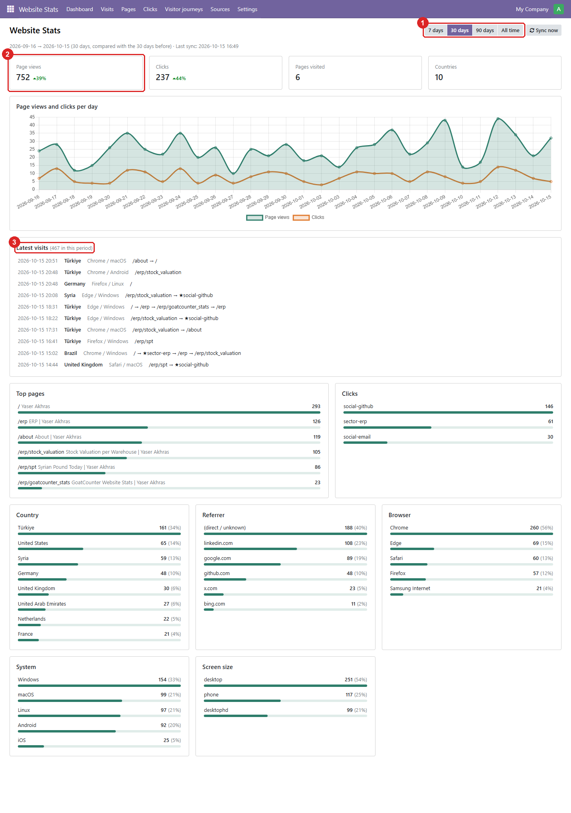
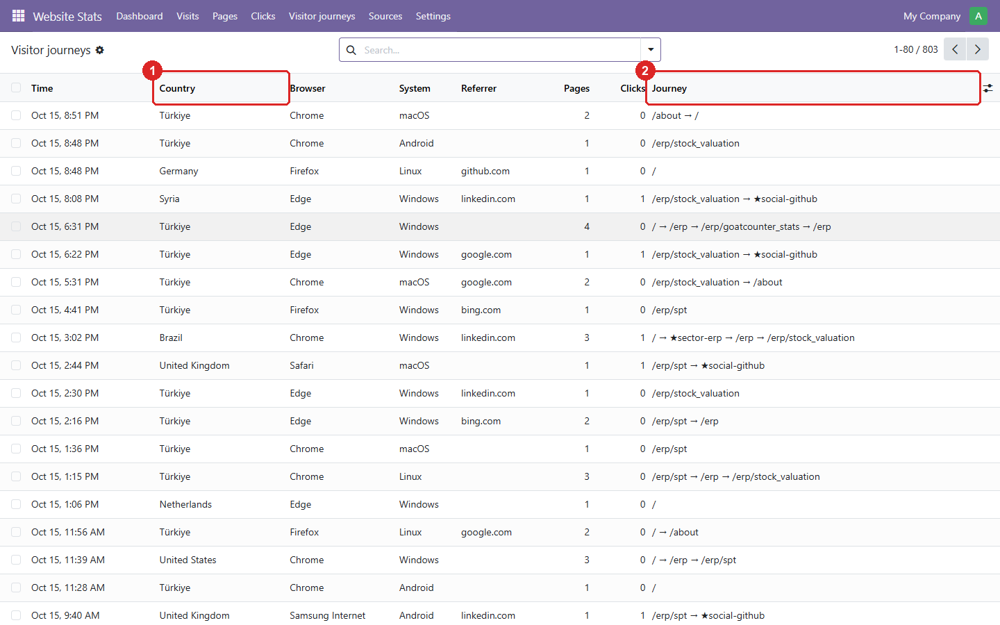

# GoatCounter Website Stats

[](https://github.com/yakhras/Odoo-GoatCounter-Stats/actions/workflows/tests.yml)

An Odoo module that pulls your website's [GoatCounter](https://www.goatcounter.com) statistics into Odoo through the GoatCounter API. You read visits, pages, clicks, traffic sources and each visitor's path through the site next to the rest of your work, instead of on goatcounter.com.

## Features
- **Dashboard** for 7 days, 30 days, 90 days or all time:
  - Page views and Clicks, compared with the previous period
  - Pages visited and Countries
  - a daily chart of page views and clicks
  - top pages, click events, and countries, referrers, browsers, systems and screen sizes with percentages
  - the latest visits
  - Every card and row opens the matching records.
- **Visitor journeys**: what each visit saw and clicked, in order. For example, a visitor from Brazil: `/` → ★ `sector-erp` → `/erp` → `/erp/stock_valuation`. Visits come from GoatCounter's CSV export and are grouped by GoatCounter's session.
- **Click events**: every element tagged `data-goatcounter-click="<name>"` on your site is counted per day.
- **Pages, Visits, Sources**: per-day records with list, pivot and graph views.
- **Hourly sync**:
  - totals for today and yesterday, plus the new visits since the last import
  - a **Sync now** button, and a **Backfill** from any date
- **The API key is never stored in the database**: it is read from the `GOAT_COUNTER_KEY` environment variable, so it is not in backups either.
- **Admins only**: only users with Settings access see the app and the data.

What it can't show: names, emails or IP addresses. GoatCounter doesn't collect them. A visit is one browser session, not a person, and visitors with ad blockers aren't counted.

## Requirements
- Odoo 18.0 (Community or Enterprise). It depends only on `base_setup`.
- The Python package `requests`, which comes with Odoo.
- A GoatCounter site and an API key with the **Read statistics** and **Export** permissions. Export is needed for visitor journeys.
- Outgoing HTTPS from the Odoo server to `<code>.goatcounter.com`.

## Installation
1. Clone the repository on the `18.0` branch next to your other addons:
   ```
   git clone -b 18.0 https://github.com/yakhras/Odoo-GoatCounter-Stats.git
   ```
2. Add the clone's folder to `addons_path` and restart Odoo.
3. Apps → update the apps list → install **GoatCounter Website Stats**.

## Configuration
1. In GoatCounter, open **Settings → API** and create a key with **Read statistics** and **Export**.
2. Give the key to the Odoo process as the `GOAT_COUNTER_KEY` environment variable. With docker compose:
   ```yaml
   services:
     odoo:
       environment:
         GOAT_COUNTER_KEY: ${GOAT_COUNTER_KEY}   # the value lives in .env, not in git
   ```
   Then recreate the container (`docker compose up -d odoo`).
3. Open **Website Stats → Settings** and enter the **GoatCounter site code**, the `<code>` of `https://<code>.goatcounter.com`. **API key found** must say yes.
4. Set **Backfill from** to the day you started counting, then press **Backfill**.

Days are grouped in the timezone of your GoatCounter account, the same as on the GoatCounter dashboard.

## Usage
| Menu | What you see |
|---|---|
| **Website Stats → Dashboard** | all metrics at a glance; this is the app's start page |
| **Website Stats → Visits** | visits per day (graph, pivot, list) |
| **Website Stats → Pages** | visits per page per day |
| **Website Stats → Clicks** | click events per day |
| **Website Stats → Visitor journeys** | one row per visit (time, country, browser, pages, clicks, journey). Open a visit for its timeline. Filter by country or by a page or click. |
| **Website Stats → Sources** | countries, referrers, browsers, systems, screen sizes per day |
| **Website Stats → Settings** | site code, key status, last sync results, **Sync now**, **Backfill** |

The screenshots below use **generated demo data**, not real visitors.

**Dashboard:** choose the period (1). The cards (2) compare each number with the previous period of the same length. **Latest visits** (3) shows the path of each recent visit; click one to open it. Every card and row opens the matching records. A country row opens the visits from that country.



**Visitor journeys:** one row per visit, with its country (1) and the pages and clicks it went through, in order (2). Clicks are marked with ★.



**One visit:** where it came from and when (1), and the timeline of what this visitor saw and clicked (2). Clicks are highlighted.


**Settings:** the site code and whether the API key was found in the environment (1). The sync results, Sync now and Backfill (2).


Totals are updated every hour. GoatCounter allows **one export per hour**, so a visit shows up in Visitor journeys within about an hour. "Waiting" in **Visits import** means the module will retry next hour; it is not an error.

## Tests
```
odoo -d <throwaway_db> -i goatcounter_stats --test-tags /goatcounter_stats --stop-after-init
```
The tests replay recorded API responses and a sample export (`goatcounter_stats/tests/data`). They need no network and no key. GitHub Actions runs them on every push.

## Author
[Yaser Akhras](https://yaserakhras.com) · [@yakhras](https://github.com/yakhras)

## License
AGPL-3.0 or later. See [LICENSE](LICENSE).
